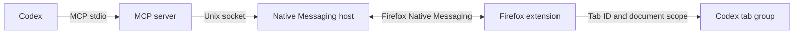

# Architecture

| Workspace | Responsibility |
| --- | --- |
| [extension](../extension) | Popup, tab ownership, site grants, and page operations. |
| [native-host](../native-host) | Transport between Firefox and the current macOS user's Unix socket. |
| [mcp-server](../mcp-server) | MCP tool schemas, descriptions, annotations, and connection errors. |
| [protocol](../protocol) | Validated request and response envelopes, URL checks, and byte framing. |

## Browser scope

Selecting **Connect Codex** binds a session to the popup's Firefox window. The extension creates a real Firefox tab group on demand. It checks both a session-owned tab handle and the current window and group before accessing a tab. An arbitrary tab dragged into the group remains outside the session until explicitly shared. Moving a managed tab out of the group or closing the window revokes access.

New tabs use `active: false`. Mutating page commands also check that the work tab is behind another tab. The extension returns to the user for links aimed at new tabs, download links, and forms with unsupported destinations. A website can have its own navigation or dialog behavior.

Firefox's domain permission is needed for content scripts. The extension additionally records exact approved origins in memory to distinguish scheme and port. Start a fresh session after stopping, restarting Firefox, or switching profiles. A permission previously granted to Firefox still requires confirmation in the extension for a new session.

## Connection recovery

The native host announces readiness once its Unix socket is listening. If an established host exits, the extension tries to reopen the connection while retaining the current window, tab handles, and approved origins in memory. It makes up to three attempts before offering **Retry connection**. A successful MCP exchange renews the retry budget.

Each request belongs to the connection that received it. A disconnect interrupts outstanding waits and blocks further browser operations from that request. An operation Firefox already received can finish, so the client returns `OUTCOME_UNKNOWN` for an interrupted mutation. **Stop access** and closing the workspace window end the session and cancel recovery. [Firefox Native Messaging lifecycle](https://developer.mozilla.org/en-US/docs/Mozilla/Add-ons/WebExtensions/API/runtime/connectNative)

## Tool workflow

| Need | Tool |
| --- | --- |
| Inspect the connection and pending site grants | `firefox_status` |
| Find known workspace tabs | `firefox_list_tabs` |
| Open or change a background page | `firefox_open_tab`, `firefox_navigate` |
| Read text and find interactive elements | `firefox_snapshot` |
| Act on an element from the latest snapshot | `firefox_click`, `firefox_fill` |
| Close a tab created by the workspace | `firefox_close_tab` |

Page actions take the opaque tab handle, snapshot token, and element ID. Element references live in the isolated browser document and are checked against the current page before use. Take a fresh snapshot after a successful action or a `STALE_SNAPSHOT` response. `SITE_PERMISSION_REQUIRED` identifies the origin to approve in the popup. An `OUTCOME_UNKNOWN` response means an action may have reached the page. Inspect the page before a retry.

## Data handling

The extension sends data to a native process identified by an explicit Firefox add-on ID. Local processes under the same OS user can access the socket, which lives in a directory owned by that user with mode `0700`. The host accepts one in-flight command.

Snapshots include bounded visible text, the current URL and title, and short labels for supported controls. They omit password and hidden form fields and avoid collecting input values. Visible text can include private information. Only share tabs and approve sites you want Codex to use. The result passes through your local MCP client and is subject to its conversation data settings.

The extension exposes a fixed set of operations and runs its bundled scripts. It does not provide arbitrary JavaScript, browser history, clipboard access, or credential extraction. Page content is untrusted input to Codex. The extension enforces permissions independently of instructions extracted from pages.
